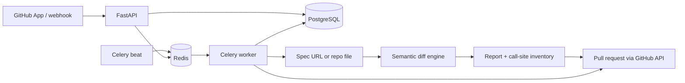

# API Radar

[](https://github.com/nxkazu/api-radar/actions/workflows/ci.yml)

API Radar watches the external APIs a repository depends on. It tracks OpenAPI 3.x
specs, diffs them semantically on every change, classifies what will actually break
clients, and opens a migration pull request with a report and safe mechanical rewrites.

Built for the failure mode where an upstream API ships a contract change and you find
out from a stack trace in production.

```text
petstore 1.4.0 -> 2.0.0
21 breaking, 6 risky, 23 non-breaking (50 total)

Breaking changes:
  - DELETE /pets/{petId}: DELETE /pets/{petId} was removed
  - GET /pets › parameter query.page_size: New required query parameter 'page_size'
  - GET /pets › response 200 › application/json › items › properties.status:
    Enum values added: ['"archived"']
  - POST /store/orders › response 400: Response 400 was removed
  ...
```

## Why the diff engine matters

A text diff of two OpenAPI documents is noise. API Radar compares the *contract*
instead: it resolves local `$ref`s, flattens `allOf`, normalises `nullable`, and judges
each difference by direction. The same enum change is safe in a request and breaking in
a response:

| Change | Request | Response |
|---|---|---|
| Enum value removed | 🔴 breaking — clients still send it | 🟢 safe — server just returns less |
| Enum value added | 🟢 safe | 🔴 breaking — clients may not handle it |
| Property removed | 🟠 needs review — strict servers reject unknown fields | 🔴 breaking — clients read it |
| New required property | 🔴 breaking — clients must send it | 🟢 safe — it is always present |
| Value may become `null` | 🟢 safe | 🔴 breaking — clients do not handle null |
| New required parameter | 🔴 breaking | — |
| Response status removed | — | 🔴 breaking |
| Security requirement added | 🔴 breaking | — |

Every change carries a stable `kind`, a spec pointer, before/after values and a
suggested action. Reports are deterministic and fingerprinted, so duplicate alerts are
easy to collapse.

## Quickstart (offline, ~60 seconds)

No database, no Redis, no GitHub credentials needed — the diff engine and fix generator
are pure Python:

```bash
git clone https://github.com/nxkazu/api-radar
cd api-radar
uv venv --python 3.12 .venv && uv pip install --python .venv/bin/python -e ".[dev]"

# Full report, exit code 1 when breaking changes exist (CI gate)
.venv/bin/python -m app.cli diff demo/before.yaml demo/after.yaml --exit-code

# See detection + mechanical rewrite of a real call-site
.venv/bin/python scripts/demo.py
```

`scripts/demo.py` also finds the removed `/v1/owners/{ownerId}` path in
`demo/callsites/petstore_client.py`, rewrites it to `/v2/...`, and prints a unified diff.

## Run the full stack

```bash
cp .env.example .env          # optional: add a GitHub token / App credentials
docker compose up --build -d
```

| Service | Purpose |
|---|---|
| `api` | FastAPI on [localhost:8000](http://localhost:8000), docs at `/docs` |
| `worker` | Celery worker: fetches specs, diffs, opens PRs |
| `beat` | Scheduled rescans (`APIRADAR_SCAN_INTERVAL_MINUTES`, default 6h) |
| `migrate` | One-shot `apiradar initdb` |
| `db` / `redis` | PostgreSQL 16 and Redis 7 |

Local development without Docker:

```bash
python3.12 -m venv .venv && . .venv/bin/activate
pip install -e ".[dev]"
export APIRADAR_DATABASE_URL=sqlite+pysqlite:///./apiradar.db
apiradar initdb
uvicorn app.main:app --reload
```

When no broker is reachable, scans run inline in the API process instead of failing —
useful for a single-process demo.

## Track a spec

```bash
# Register a repository
curl -s localhost:8000/api/v1/repositories \
  -H 'content-type: application/json' \
  -d '{"full_name": "acme/petstore", "default_branch": "main"}'

# Track one OpenAPI document (URL or repo path)
curl -s localhost:8000/api/v1/specs \
  -H 'content-type: application/json' \
  -d '{"repository_id": 1, "name": "petstore",
       "source_type": "url", "source": "https://api.petstore.dev/openapi.json"}'

# Scan now (first scan records the baseline)
curl -s -X POST localhost:8000/api/v1/specs/1/scan

# Browse results
curl -s localhost:8000/api/v1/scans/1
curl -s localhost:8000/api/v1/scans/1/report          # markdown
curl -s 'localhost:8000/api/v1/scans/1/changes?severity=breaking'
```

Ad-hoc diff, no persistence:

```bash
curl -s localhost:8000/api/v1/diff -H 'content-type: application/json' \
  -d '{"before": {...}, "after": {...}, "spec_name": "petstore"}'
```

## GitHub App setup

1. Create a GitHub App with **Contents: read & write**, **Pull requests: read & write**,
   **Metadata: read**.
2. Subscribe to **Push** and **Installation repositories** events; set the webhook URL to
   `https://<your-host>/webhooks/github` and a secret.
3. Install the App on the repositories you want to track.
4. Configure:

```bash
APIRADAR_GITHUB_APP_ID=123456
APIRADAR_GITHUB_APP_PRIVATE_KEY=/run/secrets/app.pem   # PEM contents also accepted
APIRADAR_GITHUB_WEBHOOK_SECRET=<secret>
```

For local use, a personal token is enough:

```bash
APIRADAR_GITHUB_TOKEN=ghp_...   # repo scope
```

On installation, API Radar registers the repositories, auto-discovers files matching
`*openapi*` / `*swagger*` (`.yaml`, `.yml`, `.json`) and records baselines. Pushes to the
default branch queue a rescan. Webhook signatures are verified with HMAC-SHA256.

## Automated migration PRs

With `APIRADAR_AUTO_PR=true`, a scan that finds breaking changes:

1. inventories every literal call-site for removed/renamed paths (`file:line` +
   snippet),
2. detects **path renames** (`/v1/owners/{id}` → `/v2/owners/{id}`) and rewrites
   quote-delimited path literals in Python, JS/TS, Go, Ruby, Java, etc., preserving
   f-string fields and JS template expressions,
3. commits the rewrites plus a full markdown report to
   `.apiradar/reports/<spec>-<base>-to-<head>.md` on branch `apiradar/<spec>-<scan>`,
4. opens a pull request with the severity summary and a review checklist.

Nothing is merged automatically. The repository's own CI runs on the PR; for a
hermetic local check, the CLI can run the suite in a disposable container:

```bash
apiradar verify ./checkout --cmd "pip install -e . && pytest -q" --network bridge
```

Docker isolation is opt-in (`--network none` by default), because dependency installs
usually need network access.

Safety rails: only path literals are rewritten, never request/response payload logic;
large files, vendored directories and lockfiles are skipped; a failed PR never fails the
scan (the error lands on `scan.pr_error`).

## Architecture



Request path: webhook/API creates a `Scan` row, Celery fetches the current document,
parses it (local `$ref` resolution, `allOf` flattening), diffs against the stored
baseline, persists every `Change`, renders a Markdown report, and optionally opens a PR.
The baseline then advances, so each alert is delivered once.

## Configuration

| Variable | Default | Description |
|---|---|---|
| `APIRADAR_DATABASE_URL` | Postgres DSN | Any SQLAlchemy URL; SQLite works for local use |
| `APIRADAR_REDIS_URL` | `redis://localhost:6379/0` | Celery broker/backend |
| `APIRADAR_GITHUB_TOKEN` | — | PAT fallback |
| `APIRADAR_GITHUB_APP_ID` | — | GitHub App ID |
| `APIRADAR_GITHUB_APP_PRIVATE_KEY` | — | PEM contents or path |
| `APIRADAR_GITHUB_WEBHOOK_SECRET` | — | When set, signatures are enforced |
| `APIRADAR_AUTO_PR` | `false` | Open migration PRs for breaking scans |
| `APIRADAR_SCAN_INTERVAL_MINUTES` | `360` | Beat schedule |
| `APIRADAR_CELERY_TASK_ALWAYS_EAGER` | `false` | Run tasks inline |
| `APIRADAR_MAX_REPO_FILES` | `4000` | Cap for call-site collection |
| `APIRADAR_MAX_PATCH_FILES` | `25` | Max files rewritten per PR |

## Project layout

```text
app/
  core/
    openapi.py      # parsing, local $ref resolution, allOf flattening
    diff.py         # direction-aware semantic diff engine
    report.py       # markdown rendering
    fixgen.py       # rename detection, literal rewriting, call-site inventory
  services/
    github.py       # GitHub App/REST client, commit + PR flow, webhook HMAC
    specs.py        # spec fetching + repository discovery
    scanner.py      # scan orchestration and PR creation
    sandbox.py      # Docker test runner
  api/routes/       # FastAPI routers
  workers/          # Celery app and tasks
  main.py, cli.py, models.py, db.py
demo/               # before/after Petstore specs + a call-site to migrate
tests/              # 59 tests
```

## Tests

```bash
.venv/bin/pytest -q        # 59 tests, no network or Docker required
.venv/bin/ruff check app tests scripts
```

Coverage focuses on behaviour that can break silently: severity per direction,
`$ref`/`allOf`/recursive schemas, baseline advancement, failed fetch/PR paths,
webhook signature verification, GitHub commit sequencing, and the CLI CI gate.

## Limitations and roadmap

- OpenAPI **3.x only**; local `$ref`s only. Remote refs fail loudly rather than diffing
  incorrectly.
- Mechanical rewrites cover path renames. Payload/field migrations are reported, not
  auto-edited — guessing at business logic is how tools lose trust.
- The HTTP API has no authentication in v1. Put it behind a gateway/private network
  before exposing it.
- Roadmap: Postman/GraphQL/gRPC sources, Slack/email notifications, per-repository
  policy (`fail on breaking`, ignored rules), GitHub Checks integration, web dashboard.

## License

MIT